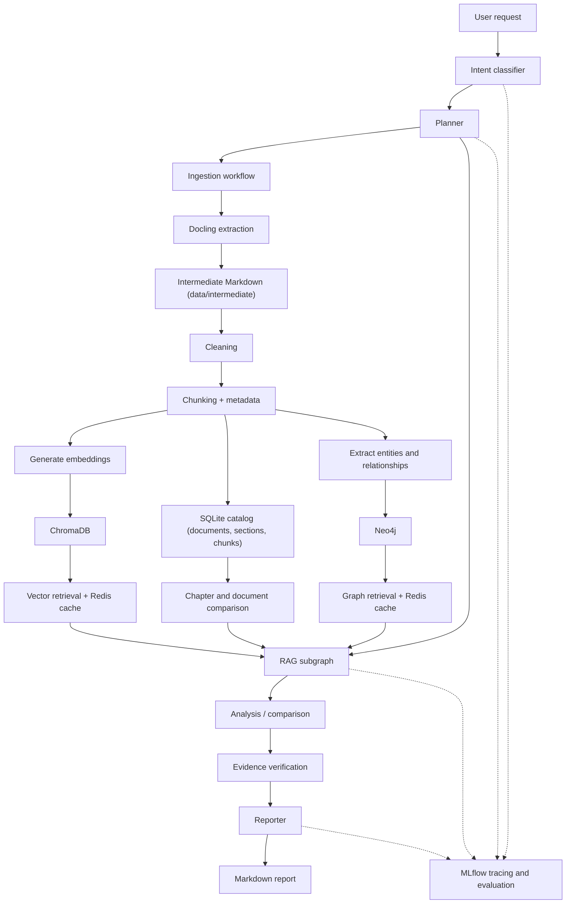
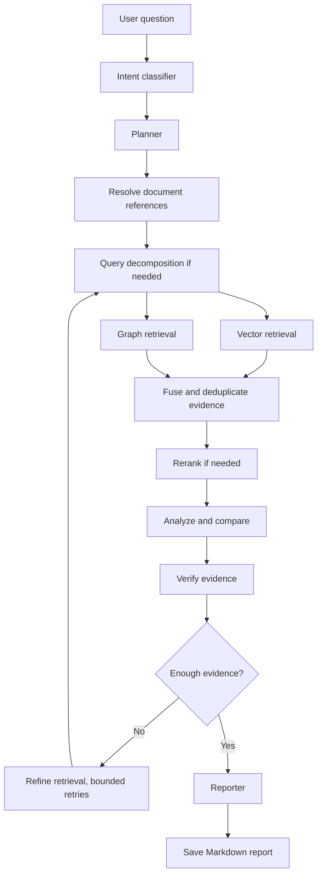

# LangGraph Research Agent — Lightweight Implementation Plan

## 1. Objective

Build a Python research agent using LangGraph that accepts Wikipedia URLs, other web links, and PDF links, extracts their content, indexes them in vector and graph databases, and answers questions requiring evidence from one or multiple documents.

The agent must:

- Ingest web pages and PDF documents.
- Convert extracted content to Markdown and split it into chunks.
- Store embeddings in ChromaDB.
- Store document entities and relationships in Neo4j.
- Use hybrid retrieval combining vector search and graph traversal.
- Support query decomposition and optional HyDE for complex questions.
- Answer questions involving multiple documents and methodology comparisons.
- Generate a Markdown report for every completed research request.
- Cache vector and graph retrieval results in Redis.
- Use MLflow for tracing, experiment tracking, and basic evaluation.
- Run locally with minimal setup.

**No PostgreSQL. No OpenTelemetry, Grafana, or Prometheus. No database writes for research findings. SQLite is used only as a local catalog of document, section, and chunk metadata.**

### Models (MLflow AI Gateway)

All models are called through the MLflow AI Gateway. The application uses endpoint names, not provider model names.

| Endpoint | Provider | Backing model | Strategy |
|---|---|---|---|
| `nemotron-3-ultra` | ollama + openrouter | `nemotron-3-ultra` (ollama), `nvidia/nemotron-3-ultra-550b-a55b:free` (openrouter) | 0.5 / 0.5, `REQUEST_BASED_TRAFFIC_SPLIT` |
| `nemotron-super` | ollama | `nemotron-3-super:cloud` | 1.0 |
| `deepseek-v4.1-flash` | not verified (listed by gateway, no config details exposed) | not verified | not verified |
| `open-ai-embedding` | openai | `text-embedding-3-small` | 1.0 |

`nemotron-3-ultra` is the default chat endpoint. `nemotron-super` is an alternative chat endpoint. `deepseek-v4.1-flash` is not yet usable (see below). `open-ai-embedding` is optional; it produces 1536-dimensional vectors, so switching from the local model requires re-embedding all chunks. Each embedding model writes to its own Chroma collection (`research_chunks_<model slug>`), so switching does not overwrite existing vectors.

`deepseek-v4.1-flash` is listed by the gateway, but its backing model is unverified. Do not use it until the gateway configuration is confirmed and tested.

## 2. Technology stack

| Component | Technology | Purpose |
|---|---|---|
| Language | Python | Application logic |
| Orchestration | LangGraph | Research workflow |
| LLM | MLflow AI Gateway chat endpoint | Planning, analysis, graph extraction, reporting |
| Embeddings | Local sentence-transformers model (default) | Chunk embeddings |
| Vector DB | ChromaDB | Semantic retrieval |
| Graph DB | Neo4j | Entity and relationship retrieval |
| Cache | Redis | Vector and graph retrieval-result caching |
| Document extraction | Docling | Convert web pages and PDFs to Markdown, keep PDF page numbers |
| Intermediate store | Local files in `data/intermediate/` | Raw Docling Markdown and metadata |
| Catalog | SQLite (`data/catalog.sqlite`) | Document, section tree, and chunk-to-section metadata for comparison and re-ingest |
| Observability/evaluation | MLflow | Traces, experiments, metrics, evaluation results |
| Testing | pytest | Basic unit and integration tests |
| Runtime | Python 3.14 (fallback 3.13, see detailed plan Step 1) + Docker Compose | Run the application and supporting services |

Use a simple CLI initially. Add FastAPI or a user interface only if time permits.

## 3. Architecture



Ingestion and research are separate workflows. Ingestion can run when a new URL or PDF is supplied; research operates on already indexed documents.

All completed research requests end at the Reporter, which generates the Markdown report. There is no relational database or findings-persistence workflow.

## 4. User request types

Support these request types initially:

1. **Ingest a document:** "Ingest this Wikipedia URL."
2. **Single-document Q&A:** "Explain the methodology in Document 1."
3. **Cross-document comparison:** "Compare Topic A in Document 1 with Topic B in Document 12."
4. **Methodology alignment:** "Does the approach in Document 1 align with the methodology in Document 6?"
5. **Multi-document synthesis:** "Summarize common findings across these documents."
6. **Contradiction analysis:** "Identify conflicting claims between Document 2 and Document 8."
7. **Chapter comparison:** "Compare chapters 1-3 of Document 1 with chapters 4-6 of Document 2."

Use a lightweight intent classifier to identify the request type, document references, topics, and whether ingestion is required.

Do not build a complex autonomous multi-agent system. Use regular LangGraph nodes and one reusable RAG subgraph.

## 5. Ingestion workflow

Implement the following pipeline:

1. Validate the supplied URL.
2. Determine whether it points to a web page or PDF.
3. Convert the page or PDF to Markdown with Docling.
4. Save the raw Markdown and metadata to `data/intermediate/`. Skip conversion when the source bytes match the stored `source_sha256` and the run is not forced (see detailed plan Step 12).
5. Preserve the title, source URL, headings, and PDF page numbers.
6. Clean the Markdown (remove boilerplate and citation markers) and split it into manageable chunks.
7. Attach stable document IDs, section IDs, chapter numbers, chunk IDs, and source metadata. Build the section tree from Docling headings.
8. Generate embeddings and upsert chunks into ChromaDB.
9. Extract important entities, topics, claims, and relationships.
10. Store the graph and source provenance in Neo4j.
11. Write the document, section tree, and chunk-to-section links to the SQLite catalog. Re-ingest replaces only that document's rows.

### Initial document support

- Wikipedia article URLs.
- General HTML web pages.
- Direct PDF links.

Do not implement OCR, complex table reconstruction, or numerous parser fallbacks during the initial build.

Make ingestion idempotent using document and chunk identifiers. Use stable IDs so the same source can be ingested again without creating unnecessary duplicates.

## 6. RAG and research workflow

Implement this LangGraph flow:



### Query routing

The intent classifier assigns one of the seven request types from section 4. Each request type maps to one route:

| Request type | Route | Retrieval path |
|---|---|---|
| Ingest a document | `ingest` | Ingestion workflow, then the question is answered if one was asked |
| Single-document Q&A | `simple` | Vector retrieval only |
| Multi-document synthesis | `relational` | Graph retrieval, then vector retrieval for the connected chunks |
| Methodology alignment | `relational` | Graph retrieval (Methodology nodes), then vector retrieval |
| Contradiction analysis | `relational` | Graph retrieval (CONTRADICTS edges), then vector retrieval |
| Cross-document comparison | `compare` | Recursive comparison in `compare.py` |
| Chapter comparison | `compare` | Recursive comparison in `compare.py` |

- An unclear label falls back to `simple`, the safe default.
- Rules run first for explicit cues (for example "compare", "chapter N of", "difference between", "ingest"). An LLM classifier handles the remaining questions and returns one request-type label.

### Retrieval requirements

**Vector retrieval**
- Search ChromaDB for relevant chunks.
- Support filtering by document ID.
- Return source metadata, chunk IDs, and relevance scores.

**Graph retrieval**
- Retrieve related topics, entities, claims, and methodology relationships from Neo4j.
- Return the source chunk references supporting the retrieved relationships.
- Use predefined Cypher queries or a small set of controlled query templates.

**Query decomposition**
- Split complex questions into smaller retrieval tasks.
- Retrieve evidence for each topic independently before comparing results.

**HyDE**
- Implement as an optional retrieval enhancement if time permits.
- Use hypothetical text only for searching, never as factual evidence.

**Evidence verification**
- Check whether important conclusions are supported by source chunks.
- Identify conflicting claims and missing evidence.
- Stop after a small, configurable number of retrieval retries.
- Clearly report uncertainty when evidence is insufficient.

Start with hybrid retrieval and simple query decomposition. Add HyDE and reranking only after the basic workflow works.

## 7. Redis caching

Redis is used exclusively for **vector retrieval results and graph retrieval results**.

Do not cache LLM responses, embeddings, documents, or generated reports.

### Vector retrieval cache

Cache results returned by ChromaDB using a key derived from:

- Normalized retrieval query.
- Document filters and scope.
- Top-k and other retrieval parameters.
- Embedding model version.
- Chroma collection or corpus version.

### Graph retrieval cache

Cache Neo4j query results using a key derived from:

- Graph query template and parameters.
- Document scope.
- Graph schema or corpus version.
- Traversal depth and result limits.

### Cache behavior

- Check Redis before running the underlying database query.
- Return cached results on a hit.
- Store successful retrieval results on a miss.
- Use a configurable TTL, initially around 10 minutes.
- Change the cache namespace or version when indexed content changes.
- If Redis is unavailable, perform the retrieval directly and continue.
- Track basic cache hit/miss counts through MLflow or application logs.

Use deterministic, versioned cache keys. Never reuse results across incompatible document scopes or access permissions.

## 8. Neo4j graph model

Keep the initial graph small.

### Nodes

- `Document`
- `Chunk`
- `Topic`
- `Entity`
- `Claim`
- `Methodology`
- `Section`

### Relationships

- `CONTAINS`
- `DISCUSSES`
- `MENTIONS`
- `SUPPORTS`
- `CONTRADICTS`
- `RELATED_TO`
- `EVIDENCED_BY`
- `HAS_SECTION` (Document to Section)
- `HAS_SUBSECTION` (Section to Section)
- `IN_SECTION` (Chunk to Section)

Each extracted claim or relationship should retain its source chunk ID and document ID.

Use deterministic identifiers and uniqueness constraints. Do not allow the LLM to execute unrestricted Cypher queries.

## 9. Markdown reporter

The Reporter must run after successful research and evidence verification.

Generate one `.md` file per research run, with a unique filename.

Suggested report structure:

```markdown
# Research Report

## Question

## Summary

## Sources Examined

## Findings

## Comparison Matrix

## Methodology Alignment

## Supporting Evidence and Citations

## Limitations and Uncertainty
```

Include only relevant sections.

Citations should include document title, source URL, section heading, and PDF page number when available. Each important finding should reference the evidence that supports it.

Save reports in a local `reports/` directory. Return the report content or file location to the caller.

## 10. MLflow tracing and evaluation

Use MLflow as the only dedicated observability and evaluation platform.

### Tracing

Instrument the major stages of a research run:

- Intent classification and the selected route.
- Planning and query decomposition.
- ChromaDB retrieval, timed separately.
- Neo4j retrieval, timed separately.
- Chapter comparison, timed separately.
- Redis cache lookups.
- Analysis and evidence verification.
- Markdown report generation.

Capture execution duration, errors, retrieval counts, and cache hit/miss status where practical.

Use MLflow's tracing capabilities when supported by the installed version and LLM integration. If automatic tracing is unavailable for a component, use lightweight manual spans or ordinary structured logs.

### Experiment tracking

Track experiments comparing:

- Vector-only retrieval.
- Graph-only retrieval.
- Hybrid retrieval.
- Hybrid retrieval with query decomposition.
- Optional HyDE.

Log configuration parameters such as chunk size, top-k, embedding model, prompt version, and retrieval strategy.

### Basic evaluation

Create a small hand-written dataset of approximately 10–20 questions, including:

- Single-document questions.
- Cross-document comparisons.
- Methodology-alignment questions.
- Questions where the available sources do not contain enough evidence.

Evaluate retrieval relevance, citation correctness, answer completeness, and whether unsupported claims are avoided.

Keep MLflow local for the initial project. Do not set up additional observability infrastructure.

## 11. Minimal project structure

```text
wiki_reasercher/
├── app/
│   ├── main.py
│   ├── config.py
│   ├── providers.py
│   ├── graphs/
│   │   ├── ingestion.py
│   │   └── research.py
│   ├── ingestion/
│   │   ├── validate.py
│   │   ├── docling_extractor.py
│   │   ├── intermediate.py
│   │   ├── cleaner.py
│   │   └── chunker.py
│   ├── retrieval/
│   │   ├── vector.py
│   │   ├── graph.py
│   │   ├── hybrid.py
│   │   ├── query_decomposition.py
│   │   └── compare.py
│   ├── cache/
│   │   ├── redis_cache.py
│   │   └── corpus_version.py
│   ├── graph_extraction.py
│   ├── catalog.py
│   ├── analysis.py
│   ├── reporter.py
│   └── observability.py
├── data/
│   ├── intermediate/
│   ├── cleaned/
│   ├── chroma/
│   ├── catalog.sqlite
│   └── corpus_version.json
├── reports/
├── evaluations/
│   ├── dataset.json
│   └── evaluate.py
├── tests/
│   └── fixtures/
├── plan/
├── docker-compose.yml
├── .env.example
├── pyproject.toml
└── README.md
```

## 12. Two-to-three-day implementation schedule

### Day 1 — Ingestion and vector retrieval

- Set up the Python environment and local services.
- Implement Wikipedia/general web extraction and PDF extraction.
- Normalize extracted content into Markdown.
- Implement chunking and metadata.
- Generate embeddings and persist chunks in ChromaDB.
- Implement basic vector search.
- Verify ingestion using one Wikipedia article and one PDF.

**End-of-day result:** documents can be ingested and searched semantically.

### Day 2 — Graph retrieval and research workflow

- Implement basic entity, topic, and relationship extraction.
- Store the graph in Neo4j.
- Implement graph retrieval and hybrid evidence collection.
- Build the LangGraph intent-classifier, planner, analyst, verifier, and reporter workflow.
- Build the SQLite catalog and recursive chapter comparison.
- Add cross-document comparison and methodology-alignment requests.
- Generate cited Markdown reports.

**End-of-day result:** the agent can answer a cross-document question and generate a report using vector and graph evidence.

### Day 3 — Redis, MLflow, and testing

- Add Redis caching to vector and graph retrieval.
- Implement versioned cache keys and TTLs.
- Add MLflow tracing and experiment tracking.
- Create a small evaluation dataset.
- Test citation quality, cache hits, ingestion failures, and insufficient-evidence handling.
- Write setup instructions and example questions.

**End-of-day result:** a runnable hobby project with hybrid retrieval, retrieval caching, basic evaluation, and Markdown reports.

If limited to two days, prioritize a functioning end-to-end workflow and Redis caching. Keep advanced HyDE, reranking, and detailed evaluation as optional follow-up work.

## 13. Definition of done

The project is complete when:

1. A Wikipedia URL and a PDF URL can be ingested.
2. Chunks and embeddings are stored in ChromaDB.
3. Entities and relationships are stored in Neo4j with source provenance.
4. The research graph supports single-document and cross-document questions.
5. Methodology alignment uses evidence from the relevant documents.
6. Redis caches vector and graph retrieval results.
7. Completed research requests produce Markdown reports with citations.
8. MLflow records traces or equivalent stage-level tracking and basic evaluation runs.
9. The project runs locally with documented setup instructions.
10. No relational database beyond the SQLite catalog, and no unnecessary observability services, are required.

## Instructions to the coding agent

First inspect the repository and environment. Then implement the smallest working end-to-end version in the order specified above.

Prefer straightforward, testable functions over excessive abstractions. Do not create additional agents, services, databases, or caching layers unless required.

Keep configuration in environment variables, document setup commands, and ensure the project runs locally.

Prioritize correctness of source extraction, provenance, retrieval, and citations over elaborate agent behavior. The goal is a working research assistant—not a production platform.
